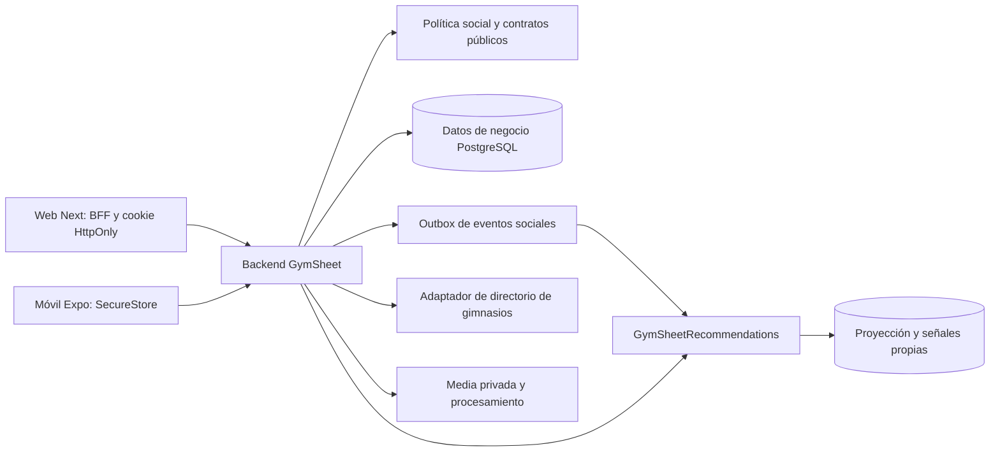

# Arquitectura y contratos de implementación

Convención de rutas: `F/` es GymSheetFrontend, `B/` GymSheetBackend, `R/` el futuro GymSheetRecommendations. R todavía no está creado. Las rutas propuestas no son endpoints existentes.

## Evidencia local y responsabilidades

| Área | Existente inspeccionado | Cambio acotado |
|---|---|---|
| Social | `B/src/modules/social/social.controller.ts`, `social.service.ts`, `social.repository.ts` | Extraer política social pública; reemplazar `requireSameTenantMember` solo en dominio social. |
| Descubrimiento | `GET /me/discovery/deck`, `POST /me/discovery/swipes`, `POST /me/discovery/swipes/undo` | Delegar ranking al motor, mantener autorización final local y exclusiones. |
| Perfil | `B/src/modules/profiles/`, fotos/onboarding existentes | Separar borrador social del onboarding de entrenamiento; DTO público mínimo. |
| Chat | `B/src/modules/chat/chat.controller.ts`, `chat.service.ts`, `chat.gateway.ts` | Audio/stickers, edición, borrados, recibos y revocación. `chat.service.ts:60` rechaza actualmente otro tenant al abrir. |
| Stories | `B/src/modules/stories/` | Conserva conexión y expiración, reemplaza restricción de tenant solo en acceso social autorizado, agrega audiencia y reacciones. |
| Moderación | `B/src/modules/moderation/moderation.controller.ts` | Reutilizar queue/cases/claim/resolve; preservar cambios locales existentes. |
| Gimnasios | `B/src/modules/facilities/public-facilities.controller.ts`, `public-facilities.mapper.ts` | Sedes públicas y directorio externo sin abrir salas, equipos o controles de acceso internos. |
| Mapa web | `F/apps/web/src/features/public-facilities/components/branches-map.tsx` | Reutilizar conceptos de marcadores/selección; separar nueva búsqueda social de mapa de sucursales. |
| Web social | `F/apps/web/src/features/social/components/descubrir-client.tsx`, `comunidad-client.tsx`, servicios | Integrar perfil, filtros, mapa y conexión con estado compartido. |
| Móvil social | `F/apps/mobile/app/(app)/(tabs)/comunidad.tsx`, `src/api/services.ts` | Dividir las nuevas responsabilidades en features; conservar cambios locales. |
| Contratos | `F/packages/schemas/src/definitions/social.ts`, `stories.ts`, `public-facilities.ts`; `packages/types/src/` | DTOs/schema compartidos, BFF web como única ruta al backend. |
| Entrenamiento | `B/src/modules/training/`, `workouts/`; cambios locales sin commit | Invitaciones en módulo nuevo que consume servicios existentes; nunca reimplementar XP. |

Búsqueda acotada de funcionalidad faltante: módulos, controladores, migraciones y archivos frontend sociales. El inventario no garantiza ausencia en ramas remotas. No incorporar automáticamente worktrees `-mapa`, `-sdk57` o `-sdk57-test`.

## Límites entre módulos



### Interfaces propuestas

```ts
type Id = string;
type SocialState = 'OFF' | 'DRAFT' | 'ACTIVE' | 'PAUSED' | 'SUSPENDED';
type Intent = 'TRAINING' | 'FRIENDSHIP' | 'DATING';
type SearchContext =
  | { mode: 'NEAR_ME'; areaId: Id; radiusKm: number }
  | { mode: 'MAP_AREA'; areaId: Id; radiusKm: number };
type DiscoveryPreferences = {
  genders: ('MAN' | 'WOMAN')[]; minAge: number; maxAge: number;
  radiusKm: number; flexibleAge: boolean; flexibleDistance: boolean;
  gymId?: Id; version: number;
};
type SocialPolicyContext = {
  actorId: Id; targetId: Id; purpose: 'DISCOVER' | 'PROFILE' | 'CONNECT' | 'CHAT' | 'STORY' | 'MAP';
};
type EligibilityDecision = { allowed: boolean; reasonCode: string; policyVersion: number };
// Implementaciones en B/src/modules/social/social-access.policy.ts:
// evaluateAccess(ctx: SocialPolicyContext): Promise<EligibilityDecision>
// No una consulta de tenant genérica que permita datos de entrenamiento ajenos.
type Candidate = { profileId: Id; score: number; reasonCodes: string[] };
type RankRequest = {
  requestId: Id; viewerId: Id; preferenceVersion: number;
  context: SearchContext; cursor?: string; limit: number;
};
type RankResponse = {
  requestId: Id; candidates: Candidate[]; nextCursor?: string;
  modelVersion: string; projectionVersion: number; generatedAt: string;
};
type SocialEvent = {
  eventId: Id; type: string; aggregateId: Id; aggregateVersion: number;
  occurredAt: string; schemaVersion: 1; payload: Record<string, unknown>;
};
type ReadReceiptPreference = {
  enabled: boolean; scope: 'CONVERSATION' | 'SELECTED' | 'ALL';
  conversationIds?: Id[]; expectedVersion: number;
};
type TrainingInviteInput = {
  recipientId: Id;
  /** Instante RFC 3339 normalizado a UTC (sufijo Z); no hora local sin offset. */
  startsAt: string;
  /** Zona IANA del lugar/horario acordado, conservada además del instante UTC. */
  timeZone: string;
  durationMinutes: number;
  place: { kind: 'GYM' | 'PUBLIC_PLACE'; placeId?: Id; label: string };
  /** OWN_ROUTINES es el default; SHARED_SESSION requiere una referencia autorizada. */
  mode: 'OWN_ROUTINES' | 'SHARED_SESSION'; routineSessionId?: Id;
  note?: string;
  /** UUID por intento lógico, estable al reintentar; alcance: actor que invita. */
  clientRequestId: Id;
};
type TrainingInviteState = 'PENDING' | 'ACCEPTED' | 'DECLINED' | 'EXPIRED' | 'CANCELLED';
type TrainingInviteDecision = 'ACCEPT' | 'DECLINE';
type TrainingInviteResponseInput = {
  expectedRevision: number;
  decision: TrainingInviteDecision;
  clientRequestId: Id;
};
type TrainingInviteRevision = {
  revision: number;
  proposerId: Id;
  startsAt: string;
  timeZone: string;
  durationMinutes: number;
  place: TrainingInviteInput['place'];
  mode: TrainingInviteInput['mode'];
  routineSessionId?: Id;
  note?: string;
  createdAt: string;
};
type TrainingInvite = {
  id: Id;
  state: TrainingInviteState;
  currentRevision: number;
  revisions: TrainingInviteRevision[];
  participants: Id[];
  /** El DTO solo devuelve el workout asociado al usuario autenticado, nunca el del otro. */
  myWorkoutId?: Id;
  createdAt: string;
  updatedAt: string;
};
```

`Id` se valida como UUID donde los modelos existentes lo exijan; IDs externos se namespacen y no se fuerzan a UUID. Catálogos existentes se reutilizan tras revisar enums. `reasonCode` interno no expone bloqueos de terceros al cliente. El campo género es autodeclarado, jamás inferido.

## Contratos HTTP propuestos

Prefijo existente `/api/v1`; web lo consume por BFF. Toda mutación valida Zod, autenticación, autorización y la versión cuando corresponda. `404` para recurso ajeno/no disponible, `409` para conflicto de versión, `422` para regla de negocio, `429` para límite; conservar el formato existente de error al adaptar códigos.

| Operación | Ruta propuesta o existente que se amplía | Semántica / dueño |
|---|---|---|
| Perfil social | `GET/PUT /me/social-profile`, `POST /me/social-profile/activate`, `PATCH /me/social-profile/state` (nuevas) | B: borrador, completar, pausar; cambios incrementan versión. |
| Preferencias | `GET/PUT /me/discovery/preferences` (nuevas) | B: normalizar rangos/consentimientos, invalidar cursores. |
| Baraja | `GET /me/discovery/deck` (existente) | B llama a R, revalida, completa página sin candidatos prohibidos. |
| Decisión | `POST /me/discovery/swipes`, `/undo` (existentes); `DELETE /me/discovery/passes` (nueva) | Idempotencia por requestId; reinicio explícito no toca bloqueos. |
| Conexiones | `GET/POST/PATCH/DELETE /me/connections...` (existentes) | Misma máquina de estados en todas las superficies. |
| Bloqueos | `GET/POST /me/social-blocks`, `DELETE /me/social-blocks/:targetId` (nuevas) | Transacción de revocación, no revelar quién bloqueó. |
| Mapa | `GET /me/social-map/areas`, `GET /me/social-map/areas/:areaId/people` (nuevas) | Celdas públicas, paginación, filtros y versión de búsqueda. |
| Gimnasios | `GET /public/facilities/branches` (existente, prefijo confirmado); nuevo `GET /me/gym-places` | DTO externo normalizado con procedencia; no acoplar a tablas administrativas. |
| Contactos | `POST/DELETE /me/contact-discovery/import`, `PATCH /me/contact-discovery/settings` (nuevas) | Procesamiento acotado, no guardar libreta completa ni devolver identificadores de otros. |
| Chat | `GET/POST /me/conversations`, `/messages`, `/messages/media`, `/read` (existentes) | Revalidar acceso en cada operación. |
| Editar/borrar | `PATCH/DELETE /me/conversations/:id/messages/:messageId` (nuevas) | `scope=ME\|EVERYONE` validado; edición texto autor y plazos. |
| Visto | `GET/PUT /me/chat/read-receipts` (nuevas) | Global/excepciones, versión atómica, sin retroactividad. |
| Stories | Endpoints existentes más `POST /me/stories/:id/reactions`, `/replies` (nuevas) | Audiencia en upload; crea mensaje autorizado con referencia. |
| Reels | `POST/GET /me/reels`, `GET /me/reels/feed`, `DELETE /me/reels/:id` (nuevas) | Feed `FOR_YOU\|CONNECTIONS`, estado de procesamiento. |
| Reels acciones | `PUT/DELETE /me/reels/:id/like`, `/save`, `/repost` (nuevas) | Unicidad por usuario/reel; guardados solo dueño. |
| Comentarios | `GET/POST /me/reels/:id/comments`, `PATCH/DELETE .../:commentId` (nuevas) | ParentId solo de un comentario raíz del mismo reel. |
| Invitaciones | `GET/POST /me/training-invitations`, `GET /me/training-invitations/:id`, `POST /me/training-invitations/:id/respond`, `/counterproposal`, `/cancel` (nuevas) | Solo participantes; revisión esperada, conexión aceptada vigente, reintento idempotente y efecto único en agenda/chat. |
| Workout del encuentro | `POST /me/training-invitations/:id/workout` (nuevo) | Solo participante de encuentro ACCEPTED; crea o reanuda únicamente el workout propio, como máximo uno por invitación/usuario. |
| Exportar agenda | `GET /me/training-invitations/:id/calendar.ics` (nueva) | Solo participante, UID estable por invitación/usuario, tiempos UTC y `TZID` IANA; exportación unidireccional. |
| Moderación | Controladores `me/reports` y `admin/moderation` existentes | Ampliar tipos de target y autorización central, no duplicar panel. |
| Recomendador interno | `POST /v1/rank/people`, `POST /v1/events`, `GET /health/live`, `/health/ready` (R nuevo) | Credencial servicio-a-servicio, no accesible desde apps. |

### Contrato H9 implementado (slice inicial)

Este slice no completa las rutas sociales propuestas en la tabla. `POST /me/reels` recibe multipart con un único campo `file`, solo `video/mp4` o `video/quicktime`, y usa el límite de bytes ya configurado para media de chat. Antes de almacenar, el backend valida la estructura ISO BMFF y la pista `vide`: obtiene tiempos de movie/track/edit list de `mvhd`, `mdhd` y `elst`, contrasta la duración muestreada con `stts`, y valida tamaños, chunks y offsets en `stsz`, `stsc`, `stco`/`co64`, asegurando que los rangos de muestras queden dentro de `mdat`. Compara la duración contra 90 segundos con aritmética entera y no confía en campos de duración del cliente. La creación es síncrona y responde `201 {ok:true,data:{id,userId,mediaUrl,durationSeconds,status,createdAt}}`, con `status: READY` y `mediaUrl: /me/reels/:id/media`.

`GET /me/reels/feed` devuelve `{ok:true,data:{items:[ReelDTO],nextCursor:null}}`, solo registros `READY` del actor autenticado, con un máximo de 50. `GET /me/reels/:id/media` exige autenticación, propiedad y estado `READY`; usa `private, no-store`, `nosniff` y lectura del almacenamiento privado. Web permite en BFF solo esas tres rutas exactas; móvil consume las dos operaciones JSON/multipart mediante su cliente API y el endpoint media protegido.

El parser valida estructura, tiempos y rangos de muestras, pero no decodifica ni transcodifica el codec. Un smoke con ffmpeg de un MP4 real de 1 s comprobó reproducción para ese archivo; no generaliza a otros codecs. Unit tests del parser: 17/17 PASS. El E2E existente sigue registrado como 2/2 PASS y no se cambió en esta actualización; la aceptación PAIR sigue BLOCKED. El pipeline asíncrono, retry de procesamiento, idempotencia de carga, feed `FOR_YOU/CONNECTIONS`, acciones, comentarios y recorte/portada siguen pendientes. La evidencia de pruebas del slice está en [H9 reels API](evidencia/h9-reels-api-2026-10-10.md).

### Contrato H10 propuesto (pendiente de implementación)

Este contrato aterriza R13–R15 y R21 para H10; no afirma que las rutas, tablas, eventos o UI ya existan. Los nombres son propuestas y deben contrastarse con los modelos, migraciones y locks reales antes de implementarlos.

**Invitación y revisiones.** La invitación tiene un estado agregado `PENDING | ACCEPTED | DECLINED | EXPIRED | CANCELLED` y una secuencia append-only de revisiones con `revision` entero que empieza en 1. Cada revisión conserva al proponente, el instante UTC `startsAt`, `timeZone` IANA, duración, lugar, modo, referencia de sesión autorizada y nota. Una contrapropuesta agrega una revisión y deja el estado en `PENDING`; no reemplaza la auditoría anterior. Solo una revisión vigente se puede aceptar o declinar. Si `expectedRevision` no coincide, el servidor responde `409 Conflict` con la revisión vigente para refrescar y volver a decidir. No se aceptan invitaciones cuyo inicio ya pasó; un proceso o lectura puede marcar `EXPIRED`, pero una invitación expirada nunca crea agenda futura.

**UTC y zona horaria.** `startsAt` requiere RFC 3339 con offset y se normaliza a UTC con `Z` al persistir y responder. `timeZone` requiere un identificador IANA válido y se conserva para mostrar el horario acordado y crear ICS. No se aceptan cadenas locales ambiguas. Un cambio de horario genera otra revisión; nunca se altera silenciosamente el instante aceptado.

**Idempotencia y concurrencia.** Cada mutación lleva `clientRequestId` UUID estable por acción lógica. El mismo actor, operación, clave y fingerprint devuelve el resultado persistido original; la misma clave de esa operación con otro payload da `409`. La unicidad propuesta en el ledger de comandos es `(actor_id, command_type, client_request_id)` con fingerprint y resultado; creación de invitación agrega además unicidad `(inviter_id, client_request_id)` en la invitación. `expectedRevision` protege responder, contraproponer y cancelar. Aceptaciones concurrentes de una revisión crean como máximo un estado `ACCEPTED`, dos participaciones de agenda y un evento de chat; outbox/agenda usan claves únicas por `(invite_id, revision, event_type)` y `(invite_id, participant_id)`. El handler vuelve a comprobar conexión/bloqueo en la transacción y se serializa con la ruta existente de desconexión/bloqueo; la entrega de una notificación también vuelve a autorizar el destino.

**Conexión y cancelación.** Crear, responder, contraproponer e iniciar workout exige que ambas cuentas estén activas y mantengan conexión `ACCEPTED`, sin bloqueo en ninguna dirección. Recurso ajeno se responde como `404`; regla de conexión vencida/revocada se rechaza sin publicar efectos. Desconectar o bloquear cancela dentro de la misma transacción todas las invitaciones `PENDING` y los encuentros `ACCEPTED` cuyo inicio aún sea futuro, retira/actualiza sus dos entradas de agenda y emite un único evento de cambio. No abre ni restaura el chat revocado. Los workouts ya iniciados o terminados permanecen en el historial individual; cancelar el encuentro no borra actividad ni XP ya registrados.

**Aislamiento de rutinas, workouts y XP.** `OWN_ROUTINES` es el modo por defecto y no comparte IDs ni detalles de rutinas: cada persona inicia con su propia rutina o flujo normal. `SHARED_SESSION` valida que quien propone pueda usar la referencia seleccionada, guarda un snapshot mínimo de ejercicios/orden/dosis aprobado para ese encuentro y no reasigna ni modifica la rutina personal de la otra persona. Cada participante crea/reanuda su propio workout, con `workoutId` y series/pesos/repeticiones separados; el contrato solo proyecta `myWorkoutId`. El progreso y XP se calculan por los servicios existentes para cada workout/usuario. El DTO de invitación nunca incluye la rutina privada completa ni datos del workout de la contraparte.

**Agenda, chat y exportación.** Al aceptar la revisión vigente, una sola transacción crea la participación/entrada de agenda de cada usuario y deja un evento deduplicable para el chat activo de la pareja. Cada participante ve el mismo encuentro y la revisión acordada, pero no la actividad del workout del otro. `POST /me/training-invitations/:id/workout` crea o reanuda la sesión propia y devuelve solo su `workoutId`. ICS es de una sola dirección: UID determinista por invitación y participante; reexportar o actualizar una revisión reutiliza el UID, sin duplicados ni sincronización inversa. Para `GYM`, la invitación no concede membresía ni acceso físico; para `PUBLIC_PLACE`, no crea reserva.

## Esquema propuesto y migraciones

Reutilizar `social.connections`, `social.discovery_passes`, `chat.conversations`, `chat.participants`, `chat.messages`, `profile.stories`, `profile.story_views`. Confirmar nombres reales al escribir cada migración.

Agregar módulos/modelos para perfil social, preferencias versionadas, bloqueos, consentimientos de mapa/contactos, ubicación privada/celda pública; recibos/excepciones/ocultaciones por usuario; audiencia/reacción de historia; reels/likes/saves/reposts/comments; invitaciones/revisiones/participantes/workout links/snapshots; external gym places/source links; outbox/deduplicación. Para H10 se propone separar `training_invites`, `training_invite_revisions`, `training_invite_participants`, snapshot de sesión compartida e idempotencia de comandos; confirmar nombres y claves de migración con el esquema real antes de ejecutar.

Constraints: pareja social canónica única activa; `(actor,target)` para bloqueo/descartes; `(user,reel)` para cada interacción; `(conversation,clientRequestId,sender)` para mensajes; `(aggregateId,aggregateVersion,eventType)` para outbox; `(consumer,eventId)` para inbox; `(invite,revision)` para revisiones; `(invite,participant)` para agenda y workout propio; `(actor,clientRequestId)` más fingerprint para idempotencia de invitaciones. Usar índices por estado, feed temporal+ID y celda pública. No asumir PostGIS instalado: adapter geográfico con bounding boxes e índice por celda primero; ADR previo a instalar extensión.

Migraciones expand/contract, columnas inicialmente compatibles, backfill medible, flag apagado y eliminación diferida de contratos antiguos. Prueba con base vacía y copia sintética de esquema anterior. Downgrade no elimina mensajes de usuario: rollback de despliegue desactiva flags; rollback de esquema destructivo requiere plan específico.

## Eventos, consistencia y media

Transacción negocio + outbox; consumidor idempotente ignora versiones antiguas. Eventos propuestos `social.profile.updated`, `social.preferences.updated`, `social.visibility.changed`, `social.connection.changed`, `social.block.changed`, `social.impression`, `social.swipe`, `social.invitation.accepted`, `social.profile.deleted`. No enviar texto de chats, agenda de contactos ni GPS preciso al recomendador.

Eventos de socket: `connection:changed`, `conversation:revoked`, `message:updated`, `message:deleted`, `read-receipts:changed`, `training-invitation:changed`. Revalidar al conectar/join/send y antes de publicar un evento pendiente; recuperación por versión y refetch al reconectar.

Media privada de chat/stories por endpoint autorizado, sin URLs públicas permanentes; al revocar, negar acceso aunque el cliente conserve la URL. Cache privada y purga en cliente. Reels pueden distribuirse por URLs temporales, retiradas al moderar/eliminar; no prometer revocación de bytes descargados. Strip EXIF de fotos públicas; verificar tipo por contenido, límites, duración y procesamiento de archivos fallidos.

## Alternativas evaluadas

1. Todo en backend actual: menor operación, incumple separación solicitada del motor.
2. **Servicio independiente con ranking explicable y aprendizaje acotado:** satisface aislamiento, cold start y trazabilidad. Opción elegida para el plan.
3. Modelo complejo/embeddings como primera entrega: requiere datos de calidad que no existen aún; se habilita evolución mediante contrato y evaluación, no se usa como sustituto de reglas.

## Fuentes técnicas consultadas

- [Google: recomendaciones basadas en contenido](https://developers.google.com/machine-learning/recommendation/content-based/basics): características declaradas y señales implícitas pueden representarse en el mismo espacio. La fórmula concreta de GymSheet es una propuesta propia, no una garantía de Google.
- [Expo Maps](https://docs.expo.dev/versions/latest/sdk/maps/): documentación consultada identifica estado alpha y necesidad de development builds. La fase mapa compara compatibilidad antes de elegir librería y no asume Expo Go suficiente.
- [Política de tiles OSM](https://operations.osmfoundation.org/policies/tiles/): revisar atribución, caché y capacidad al seleccionar proveedor.
- [Política de Nominatim público](https://operations.osmfoundation.org/policies/nominatim/): no usarlo como backend genérico de autocompletado ni para descargar todos los gimnasios. El plan selecciona proveedor contratado o servicio/dataset propio, no depende del endpoint público.

Consulta: 2026-10-08. Los presupuestos, credenciales y condiciones del proveedor se verifican en H6 antes de habilitarlo; no se ha contratado ningún servicio.
